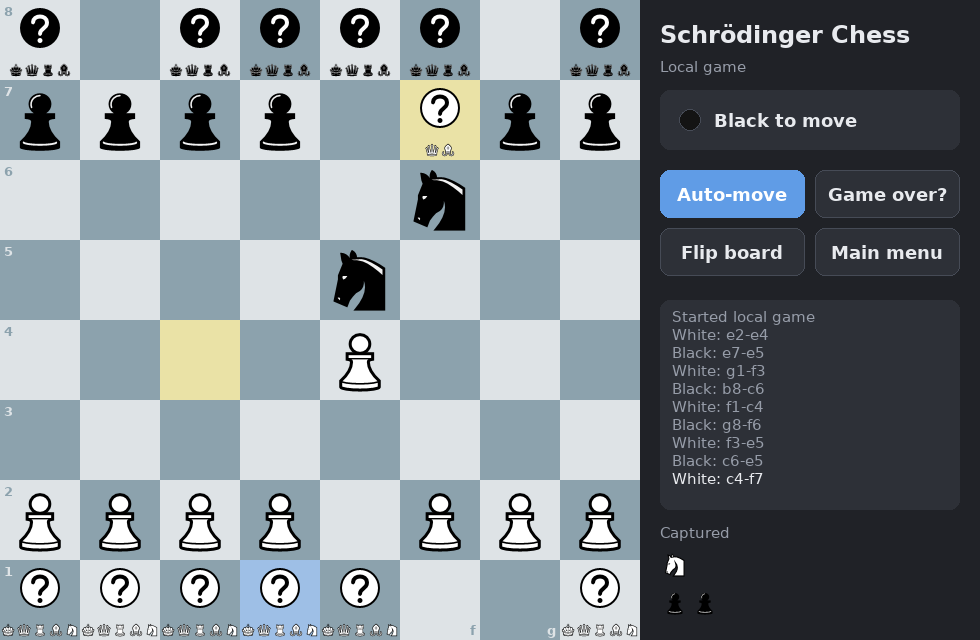

Schrödinger Chess
=================

Implementation of Haft Schrödinger chess, where chess pieces decide what they want to be.

The nature of the major pieces is unknown at first, and is determined by the moves they make.

Installation
------------

Install `uv <https://docs.astral.sh/uv/>`_, clone the `repository <https://github.com/gdalle-bot/SchroedingerChess>`_ and run

.. code-block:: bash

   uv run schroedingerchess

To host an online game, start the server with ``uv run schroedingerchess-server``.

.. toctree::
   :maxdepth: 2
   :caption: Contents

   rules
   tutorial
   formulation
   benchmark
   theory
   api
